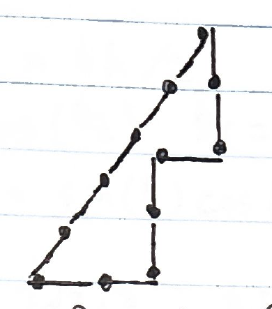
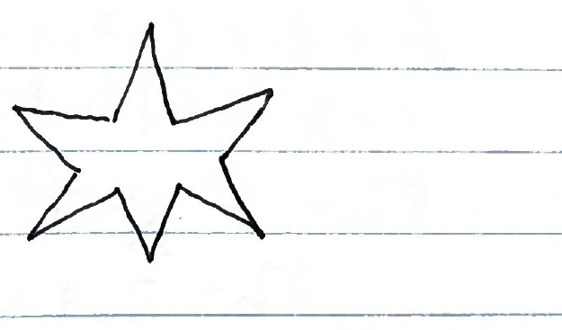
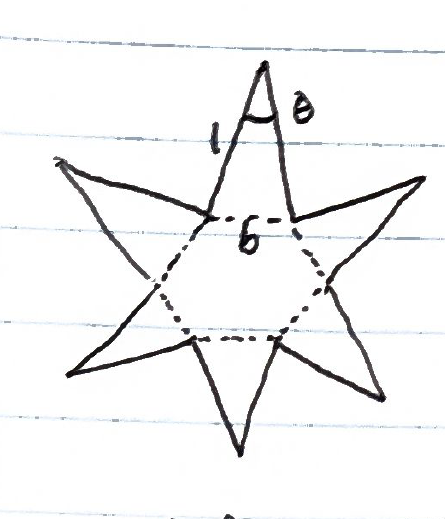
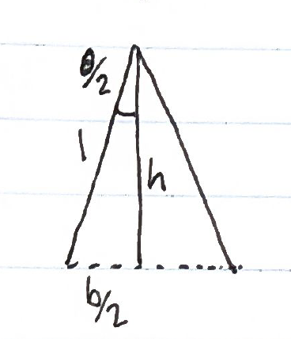

Yes, multiple ways. The neatest I found was like this:

You can see it's formed after a 3-4-5 right triangle, which has area $(3\times4)/2 = 6$. So, if we "invert" the 3 matchsticks in the corner, we reduce the area by a rectangle of area $1\times2 = 2$, for a total area of $6 - 2 = \underline{4}$

However, you can also achieve a shape with any area from 0 up to the area of the unit side-length dodecagon (which I believe is the maximum, $\sim11.196$) This can be shown with the fact you can make a 6-pointed star like so:

By varying the angle of the star's "points" you get a shape which continuously changes from one with an area as near to 0 as you desire into the regular dodecagon, achieving all areas continuously in between. In fact, the function which gives the angle needed for a desired area is:

$$f(A) = \arcsin\left(\frac{A - 3\sqrt{3}}{6}\right) + \frac{\pi}{3}$$

I show this derivation on the next page.

---

$$A_{\text{star}} = 6\,A_{\text{spike}} + A_{\text{Hex}}$$

$$A_{\text{spike}} = bh/2$$

$$h = \cos\left(\tfrac{\theta}{2}\right) \qquad \tfrac{b}{2} = \sin\left(\tfrac{\theta}{2}\right) \Rightarrow b = 2\sin\left(\tfrac{\theta}{2}\right)$$

$$A_{\text{spike}} = \sin\left(\tfrac{\theta}{2}\right)\cos\left(\tfrac{\theta}{2}\right)$$

$$A_{\text{Hex}} = \frac{3\sqrt{3}}{2}b^2 = \frac{3\sqrt{3}}{2}\left(2\sin\left(\tfrac{\theta}{2}\right)\right)^2 = 6\sqrt{3}\sin^2\left(\tfrac{\theta}{2}\right)$$

$$A_{\text{star}} = 6\sin\left(\tfrac{\theta}{2}\right)\cos\left(\tfrac{\theta}{2}\right) + 6\sqrt{3}\sin^2\left(\tfrac{\theta}{2}\right)$$

$$A_{\text{star}}/6 = \sin\left(\tfrac{\theta}{2}\right)\cos\left(\tfrac{\theta}{2}\right) + \sqrt{3}\sin^2\left(\tfrac{\theta}{2}\right)$$

$$\frac{A_{\text{star}}}{6} = \frac{1}{2}\sin\theta + \sqrt{3}\left(\frac{1-\cos\theta}{2}\right) \qquad \text{* double angle ident.}$$

$$\frac{A}{6} - \frac{\sqrt{3}}{2} = \frac{1}{2}\sin\theta - \frac{\sqrt{3}}{2}\cos\theta$$

$$= R\sin(\theta + \phi)$$

$$= R\sin\theta\cos\phi + R\cos\theta\sin\phi \qquad \text{* sum ident.}$$

$$= (R\cos\phi)\sin\theta + (R\sin\phi)\cos\theta$$

$$R\cos\phi = \frac{1}{2} \qquad R\sin\phi = -\frac{\sqrt{3}}{2}$$

$$\Rightarrow R^2(\cos^2\phi + \sin^2\phi) = \frac{1}{4} + \frac{3}{4}$$

$$R^2 = 1 \qquad R = 1$$

$$\Rightarrow \frac{\sin\phi}{\cos\phi} = \frac{-\sqrt{3}/2}{1/2} = -\sqrt{3}$$

$$\tan\phi = -\sqrt{3}$$

$$\phi = \arctan(-\sqrt{3}) = -\frac{\pi}{3}$$

$$\frac{A - 3\sqrt{3}}{6} = \sin\left(\theta - \frac{\pi}{3}\right)$$

$$\arcsin\left(\frac{A - 3\sqrt{3}}{6}\right) = \theta - \frac{\pi}{3}$$

$$\arcsin\left(\frac{A - 3\sqrt{3}}{6}\right) + \frac{\pi}{3} = \theta$$
