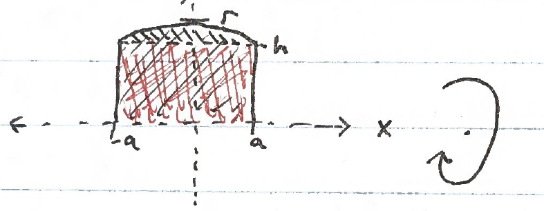

$36\pi\text{ in}^3$

I recognized this as the napkin ring problem but had fun deriving the solution. It's tricky the way it's phrased - "six inches long" sounds like it might mean the sphere has diameter 6, but that's not what is meant. Here's how I did it, using calculus on solid of revolution:

First, imagine rotating this area about the x-axis:

The top line is the arc of a circle radius $r$ centered on the origin. The resulting solid is a disc/cylinder with rounded edges. If you instead rotate only the red-shaded region, the result is a regular cylinder with radius $h$ and height $2a$ - the volume of that is $\pi h^2 \cdot 2a$. If instead you rotate only the black-shaded region, the result is what the problem describes - a sphere with a hole drilled through it (the "length" of that hole is $2a$). Our goal is to get this volume. This is equal to the volume of the first-described solid of rotation minus the second's.

Recall the formula for the disc method volume for solids of revolution:

$$V = \pi \int_a^b f(x)^2 \, dx$$

in our case the function is that of a circle with radius $r$: $f(x) = \sqrt{r^2 - x^2}$ so we have

$$V = \pi \int_{-a}^{a} \sqrt{r^2 - x^2}^{\,2} \, dx$$

$$= \pi \int_{-a}^{a} r^2 - x^2 \, dx$$

$$= \pi \left[ r^2 x - \frac{x^3}{3} \right]_{-a}^{a}$$

$$= \pi \left( \left( r^2 a - \frac{a^3}{3} \right) - \left( r^2(-a) - \frac{(-a)^3}{3} \right) \right)$$

$$= \pi \left( r^2 a - \frac{a^3}{3} + r^2 a - \frac{a^3}{3} \right)$$

$$= \pi \left( 2r^2 a - 2\frac{a^3}{3} \right)$$

$$= 2\pi \left( r^2 a - \frac{a^3}{3} \right)$$

For the volume of the first/full solid.
We already have the volume of the cylinder as $\pi h^2 \cdot 2a$ but let's put $h$ in terms of $r$ and $a$ - by looking at the illustration you can see $h = \sqrt{r^2 - a^2}$ so the 2nd volume is

$$\pi \left( \sqrt{r^2 - a^2} \right)^2 2a$$

$$= \pi (r^2 - a^2) \cdot 2a$$

$$= 2\pi (r^2 a - a^3)$$

Now we can get the final volume by subtracting this from the first volume:

$$2\pi \left( r^2 a - \frac{a^3}{3} \right) - 2\pi (r^2 a - a^3)$$

$$= 2\pi \left( r^2 a - \frac{a^3}{3} - r^2 a + a^3 \right)$$

$$= 2\pi \left( a^3 - \frac{a^3}{3} \right) = 2\pi \left( \frac{2a^3}{3} \right) = \boxed{\frac{4}{3}\pi a^3}$$

Which does not depend on $r$! For the problem we're given $2a = 6$ which works out to $36\pi$.
