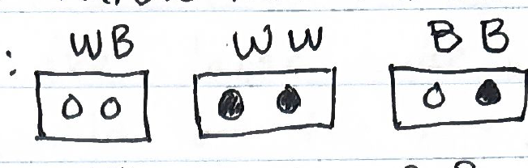
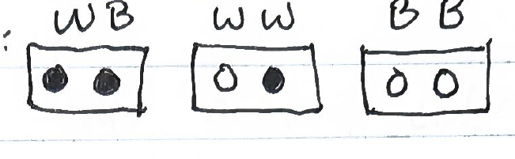

1 draw. Take 1 marble from the box labelled WB.

If white, the setup is:

If black, the setup is:

This is because the boxes must be labelled incorrectly. So the "WB" box must contain either WW or BB marbles. Then, picking 1 marble is enough to know it's full contents.

Knowing the state of the "WB" box we are left the "WW" and "BB" boxes. Assume WLOG that the "WB" box contained the WW marbles. That leaves us with the BB and WB marbles to determine the locations of. The BB marbles cannot be in the "BB" box (as that would be "correctly labelled"), so they must be in the "WW" box. That leaves the WB marbles to be in the "BB" box.

The same logic applies for if the "WB" box contains the BB marbles.
